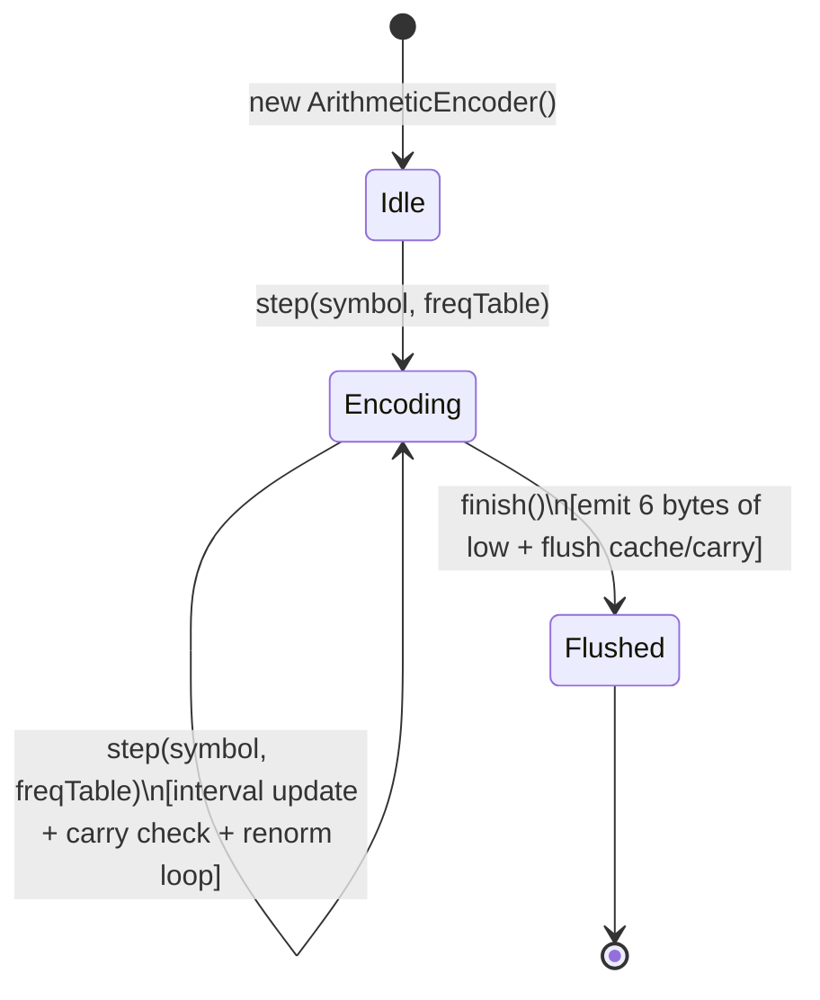
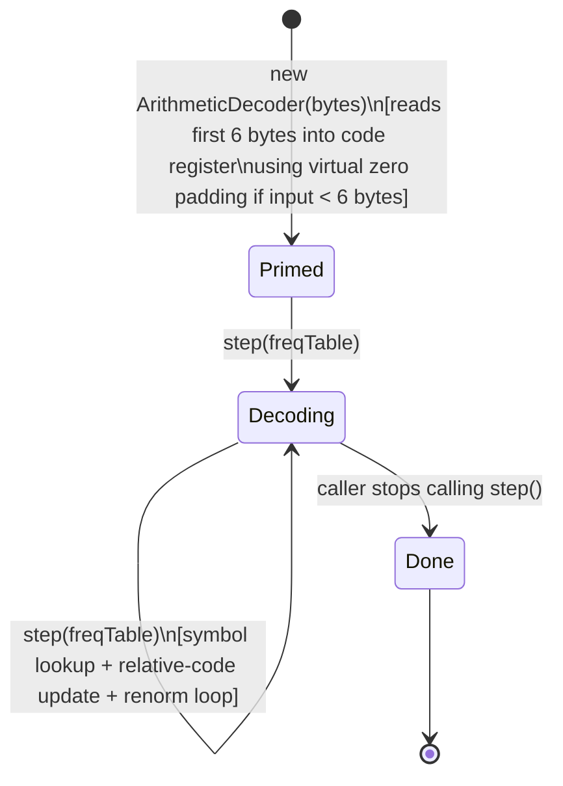

# Design Document

## Overview

The arithmetic coder is a standalone TypeScript module that compresses a symbol sequence to a byte array and decompresses it back without loss. It uses a **byte-wise range coder** (a generalisation of arithmetic coding that renormalises one byte at a time rather than one bit at a time) operating on 48-bit unsigned integer registers, with a carefully chosen divide-first renormalisation strategy that keeps every intermediate product below 2^53, the boundary of exact IEEE 754 integer representation.

The module exposes two stateful classes — `ArithmeticEncoder` and `ArithmeticDecoder` — through an incremental (one-symbol-at-a-time) interface. A `validateFrequencyTable` utility enforces the frequency-table contract at every trust boundary. A `BigIntReferenceCoder` provides an exact, slow BigInt implementation used exclusively as a correctness oracle in property-based tests.

### Why a byte-wise range coder?

The core algorithm choices for integer arithmetic coding are:

| Variant | Renorm unit | Products per symbol | Integer safety |
|---|---|---|---|
| Bit-wise arithmetic coder | 1 bit | 2 multiplications (b+f+1 bits each) | Requires wider integers |
| **Byte-wise range coder** | **8 bits** | **1 divide + 2 multiplications (all ≤ 48 bits)** | **Fits JS Number with 48-bit registers** |
| ANS (rANS/tANS) | — | 1 multiply + 1 divide | Fits, but no incremental decode interface |

ANS is ruled out because the decoder must receive the frequency table for symbol N only *after* returning symbol N−1; ANS decodes in reverse order and cannot satisfy this constraint. The byte-wise range coder produces output in forward order, matches the incremental interface, and with the Moffat et al. divide-first formula keeps all arithmetic safely within JS safe integers (see the integer-safety proof in the Architecture section).

---

## Architecture

### High-level component diagram

```mermaid
graph TD
    subgraph ArithmeticCoder Module
        VAL[validateFrequencyTable]
        ENC[ArithmeticEncoder]
        DEC[ArithmeticDecoder]
        REF[BigIntReferenceCoder]
        TYPES[Types / Interfaces]
    end

    CALLER_E[Encoding caller] -->|"new ArithmeticEncoder(alphabetSize)"| ENC
    ENC -->|"step(symbol, freqTable) → void"| ENC
    ENC -->|"finish() → Uint8Array"| CALLER_E

    CALLER_D[Decoding caller] -->|"new ArithmeticDecoder(bytes, alphabetSize)"| DEC
    DEC -->|"step(freqTable) → number"| CALLER_D
    DEC -->|static batchDecode(...)| CALLER_D

    ENC -->|calls| VAL
    DEC -->|calls| VAL

    REF -->|"encodeRef / decodeRef"| TEST[Property-based tests]
    ENC --> TEST
    DEC --> TEST
```

### Encoder state machine



### Decoder state machine



### Rule: No 32-bit bitwise operators

> **Rule: No 32-bit bitwise operators.** JavaScript `<<`, `>>`, `>>>`, `&`, `|`, and `^` silently truncate their operands to signed 32 bits. With registers wider than 32 bits, every shift and mask must be performed using multiplication and `Math.floor` division on exact integers. For example:
> - `x << 8`  becomes `x * 256`
> - `x >> 8`  becomes `Math.floor(x / 256)`
> - `x & 0xFF` becomes `x % 256`
> - `x & 0xFFFFFFFF` becomes `x % 4294967296`
>
> This rule applies in every arithmetic path in `encoder.ts`, `decoder.ts`, and `cumulative.ts`.

### Integer-safety proof

This is the critical analysis that justifies using JavaScript `number` throughout the production codec. The concern is that an intermediate product might exceed 2^53, the largest integer exactly representable as an IEEE 754 double.

**Register definitions:**

- `low`: 48-bit unsigned integer, the lower bound of the current interval. Range: [0, 2^48).
- `range`: the width of the current interval. The renormalisation invariant keeps `range ∈ [2^40, 2^48)` between steps.
- `Frequency_Total` (t): 2^24 = 16,777,216.
- `freq[s]` (a single symbol's frequency): an integer in [1, Frequency_Total].

**The Moffat et al. divide-first formula:**

Rather than computing `range * freq[s]` directly (which could overflow), the algorithm first shrinks `range` by dividing by `t`:

```
r       = Math.floor(range / t)         // r ≥ Math.floor(2^40 / 2^24) = 2^16 = 65536
newRange = r * (cumHigh - cumLow)        // ≤ (2^24 − 1) * 2^24 < 2^48
low     += r * cumLow                    // may temporarily exceed 2^48 — handled by carry
```

**Largest intermediate value analysis:**

| Expression | Upper bound | Fits in JS Number? |
|---|---|---|
| `range` (invariant) | 2^48 − 1 | Yes (< 2^53) |
| `r = Math.floor(range / t)` | Math.floor((2^48 − 1) / 2^24) = 2^24 − 1 | Yes |
| `r * freq[s]` (max freq = t = 2^24) | (2^24 − 1) * 2^24 < 2^48 | Yes (< 2^53) |
| `low + r * cumHigh` (before carry removal) | (2^48 − 1) + (2^48 − 1) < 2^49 | Yes (< 2^53) |
| `code * 256` during renorm (code < 2^48) | (2^48 − 1) * 256 < 2^56 | **No — do NOT use `<<`** |
| `(code % 2^40) * 256` during renorm | (2^40 − 1) * 256 < 2^48 | Yes (< 2^53) |

The renormalisation step extracts the top byte of `low` first (`Math.floor(low / 2^40)`), then shifts only the lower 40 bits: `(low % 2^40) * 256`. This keeps every value below 2^48 < 2^53. ✓

**Why r ≥ 2^16 matters:**

With the previous 32-bit design, `range ∈ [2^23, 2^31)` gave `r = Math.floor(range / 2^24)` which could be as small as 0 (when range < 2^24), breaking the coder entirely. Even when r = 1, the interval collapsed to at most 1 unit per symbol, losing up to 24 bits of precision per step.

With 48-bit registers, `range ≥ 2^40` guarantees `r ≥ 2^16 = 65536`. The relative error per step from truncation is at most `1/r ≤ 1/2^16`. In bits: `log2(1 + 2^{−16}) < 2^{−16} / ln(2) ≈ 0.000022 bits per symbol`. ✓

**Initial state:**
```
low   = 0
range = 2^47          (a convenient value in [2^40, 2^48))
```

**Conclusion:** Every intermediate value stays below 2^49 (and renorm intermediates below 2^48), comfortably below 2^53. Standard JS `number` is safe throughout the production codec provided bitwise operators are never used (see the No 32-bit bitwise operators rule above). No BigInt is needed in the production path.

---

## Components and Interfaces

### Module file layout

```
src/
  arithmetic-coder/
    index.ts              ← re-exports all public names
    types.ts              ← FrequencyTable, EncoderState, DecoderState interfaces
    validate.ts           ← validateFrequencyTable()
    encoder.ts            ← ArithmeticEncoder class
    decoder.ts            ← ArithmeticDecoder class
    reference-coder.ts    ← BigIntReferenceCoder (test-only oracle)
    cumulative.ts         ← buildCumulativeTable() helper
```

### Exported TypeScript types

```typescript
// types.ts

/** An array of exactly alphabetSize positive integers summing to FREQUENCY_TOTAL. */
export type FrequencyTable = Uint32Array | number[];

/** Fixed sum of all entries in a valid FrequencyTable. */
export const FREQUENCY_TOTAL = 16_777_216; // 2^24

/** Default vocabulary size matching DistilGPT-2. */
export const DEFAULT_ALPHABET_SIZE = 50_257;

/** Cumulative frequency table: cumTable[i] = sum of freq[0..i-1], cumTable[alphabetSize] = FREQUENCY_TOTAL. */
export type CumulativeTable = Uint32Array;

export interface EncoderOptions {
  alphabetSize?: number; // defaults to DEFAULT_ALPHABET_SIZE
}

export interface DecoderOptions {
  alphabetSize?: number; // defaults to DEFAULT_ALPHABET_SIZE
}
```

### validateFrequencyTable

```typescript
// validate.ts

/**
 * Validates a FrequencyTable against the codec contract.
 * Throws a descriptive Error on any violation.
 *
 * Accepts Uint32Array or number[] for performance flexibility.
 * When called from encoder/decoder internals, the combined validate-and-accumulate
 * single-pass in buildCumulativeTable may replace this function; the standalone
 * export always performs a full separate validation pass for callers who want to
 * validate without encoding.
 */
export function validateFrequencyTable(
  table: FrequencyTable,
  alphabetSize: number
): void;
```

Validation checks (in order):
1. `table.length === alphabetSize` — throws with actual length if not.
2. Every entry ≥ 1 — throws naming the first offending index.
3. Sum equals `FREQUENCY_TOTAL` — throws with the actual sum if not.

### buildCumulativeTable

```typescript
// cumulative.ts

/**
 * Builds a prefix-sum cumulative frequency table from a FrequencyTable.
 * Accepts Uint32Array or number[] to avoid JS array boxing overhead on large tables.
 *
 * cumTable[0] = 0
 * cumTable[i] = freq[0] + freq[1] + … + freq[i-1]
 * cumTable[alphabetSize] = FREQUENCY_TOTAL
 *
 * Length: alphabetSize + 1.
 *
 * Single-pass design: the encoder and decoder each pre-allocate a Uint32Array
 * cumulative buffer of length alphabetSize + 1 once at construction time.
 * Each call reuses this buffer, validating and accumulating in a single forward
 * pass: it checks each entry ≥ 1 while accumulating the running sum, then checks
 * the final sum equals FREQUENCY_TOTAL at the end of the pass. This eliminates
 * one full pass over the table per symbol step and avoids one allocation per step.
 *
 * The standalone validateFrequencyTable export still performs a separate validation
 * pass for callers who want to validate without encoding/decoding.
 */
export function buildCumulativeTable(
  freq: FrequencyTable,
  buffer: Uint32Array   // pre-allocated by encoder/decoder at construction; length = alphabetSize + 1
): CumulativeTable;

/**
 * Binary search: returns the symbol s such that
 * cumTable[s] <= value < cumTable[s + 1].
 * Used by the decoder to identify which symbol a given scaled code value falls into.
 * O(log alphabetSize).
 */
export function findSymbol(cumTable: CumulativeTable, value: number): number;
```

### ArithmeticEncoder

```typescript
// encoder.ts

export class ArithmeticEncoder {
  constructor(options?: EncoderOptions);

  /**
   * Encodes one symbol using the supplied frequency table.
   * Validates the table before use (via the combined validate-and-accumulate pass).
   * Emits zero or more bytes into the internal output buffer.
   * Throws if symbol is out of range or the table is invalid.
   *
   * Accepts Uint32Array or number[] for the frequency table.
   */
  step(symbol: number, freqTable: FrequencyTable): void;

  /**
   * Flushes the internal Codec_State to the output buffer and returns
   * the final compressed byte array.
   * After calling finish(), further calls to step() are an error.
   */
  finish(): Uint8Array;

  // encoder.ts (test-only, not exported from index.ts)
  /** Returns the number of times propagateCarry was called with carry >= 2 (i.e., at least two pending 0xFF bytes were converted to 0x00). */
  get deepCarryCount(): number;
  /** Returns the total number of times propagateCarry was called. */
  get carryCount(): number;
}
```

### ArithmeticDecoder

```typescript
// decoder.ts

export class ArithmeticDecoder {
  constructor(compressed: Uint8Array, options?: DecoderOptions);

  /**
   * Decodes the next symbol using the supplied frequency table.
   * The caller must supply the FrequencyTable for symbol N only after
   * receiving symbol N-1 from a prior call.
   * Validates the table before use (via the combined validate-and-accumulate pass).
   * Returns the decoded symbol as a number in [0, alphabetSize − 1].
   * Guarantees termination and no out-of-bounds reads for any input bytes
   * (Requirement 2.3): virtual zero-byte padding is applied both during initial
   * 6-byte priming and during renormalisation whenever pos >= input.length.
   *
   * Accepts Uint32Array or number[] for the frequency table.
   */
  step(freqTable: FrequencyTable): number;

  /**
   * Convenience batch decode wrapper. Calls step() symbolCount times,
   * supplying a fresh FrequencyTable each time via the tableSupplier callback.
   * Intended for tests and simple pipelines only.
   */
  static batchDecode(
    compressed: Uint8Array,
    symbolCount: number,
    tableSupplier: (symbolIndex: number) => FrequencyTable,
    options?: DecoderOptions
  ): number[];
}
```

### BigIntReferenceCoder

```typescript
// reference-coder.ts

/**
 * A correct-but-slow BigInt implementation of the same range coder algorithm.
 * Uses BigInt for all arithmetic — no overflow, no precision concern.
 * Accumulates renormalisation as left-shifts only (never reducing `low`), counts
 * shifts in `k`, and serialises `low` as exactly `k + 6` bytes at finish. This
 * equals the production output because the production coder emits one byte per
 * renorm shift and six bytes at finish.
 * Structurally independent of the production encoder's carry logic.
 * Intended exclusively as a correctness oracle in property-based tests.
 * Not exported from index.ts for production use.
 */
export class BigIntReferenceCoder {
  static encode(
    symbols: number[],
    tableSupplier: (symbolIndex: number) => FrequencyTable,
    alphabetSize?: number
  ): Uint8Array;

  static decode(
    compressed: Uint8Array,
    symbolCount: number,
    tableSupplier: (symbolIndex: number) => FrequencyTable,
    alphabetSize?: number
  ): number[];
}
```

---

## Data Models

### Internal codec state

Both the encoder and decoder maintain a small set of integer registers between symbols. These are stored as plain JavaScript `number` fields (safe integers throughout per the proof above). No bitwise operators are used on these fields anywhere.

#### Encoder state

```typescript
interface EncoderState {
  low:             number;   // 48-bit unsigned: lower bound of current interval; range [0, 2^48)
  range:           number;   // current range; invariant: range ∈ [2^40, 2^48)
  cache:           number;   // cached top byte awaiting carry resolution (0–255)
  carry:           number;   // count of pending 0xFF bytes that may absorb a carry
  output:          number[]; // accumulated output bytes
  _deepCarryCount: number;   // incremented in propagateCarry when carry >= 2; test-only
  _carryCount: number;      // incremented on every propagateCarry call; test-only
}
```

**Initial state:**
```
low   = 0
range = 2^47          (= 140737488355328, a convenient value in [2^40, 2^48))
cache = 0             // first call to emitByte will set this
carry = 0
```

(The `cache` field is treated as uninitialised until the first byte is extracted from `low` during the first renormalisation; a boolean sentinel or a special value such as −1 may be used to distinguish the uninitialised state from a cached byte of 0.)

#### Decoder state

The decoder uses a **relative-code** scheme: `code` holds the difference between the primed bitstream value and `low`, so the decoder never needs to maintain `low` and never needs carry logic.

```typescript
interface DecoderState {
  range: number;   // current range; invariant: range ∈ [2^40, 2^48)
  code:  number;   // relative code value: in [0, range)
  pos:   number;   // next byte index to read from compressed array
  input: Uint8Array;
}
```

**Initial state (after reading 6 prime bytes with virtual zero padding):**
```
code = 0
for i in 0..5:
  code = code * 256 + (input[i] if i < input.length else 0x00)
pos   = 6
range = 2^47
```

Virtual zero padding applies during priming: if `input.length < 6`, missing bytes are treated as `0x00`. This is the same padding rule used during renormalisation (Requirement 2.3).

### Cumulative frequency table

For each symbol step, the encoder and decoder need three values:
- `cumLow`: cumulative frequency below the symbol (sum of freq[0..s−1])
- `cumHigh`: cumulative frequency up to and including the symbol (cumLow + freq[s])
- `total`: always FREQUENCY_TOTAL = 2^24

These are computed from a `CumulativeTable` (a `Uint32Array` of length `alphabetSize + 1`) that is pre-allocated once per encoder/decoder instance and reused every step via the single-pass `buildCumulativeTable`. The table must be rebuilt per step because the frequency table may change between symbols (the LM updates its model after each decoded token).

For the decoder, `findSymbol` performs a binary search on the cumulative table using the scaled code value `Math.floor(code / r)` where `r = Math.floor(range / FREQUENCY_TOTAL)`.

---

## Encoder_Step and Decoder_Step: pseudocode

### emitByte helper (encoder)

The encoder uses an LZMA-style cache-byte scheme to handle carries without scanning backwards through the output buffer.

```
// Called each time the renorm loop extracts a byte from `low`.
function emitByte(byte):
  assert(byte <= 0xFF)                // extracted byte is always a single byte
  if cache is uninitialised (first call):
    cache = byte
    return
  if byte < 0xFF:
    // No carry can propagate: flush cache then all deferred 0xFF bytes, then cache the new byte.
    output.push(cache)
    for i in 0..carry-1: output.push(0xFF)
    carry = 0
    cache = byte
  else:  // byte == 0xFF
    // Carry might still propagate into this byte from a future step.
    carry = carry + 1
```

### Carry propagation on overflow

When an interval update causes `low ≥ 2^48`, the encoder subtracts `2^48` to restore `low` to [0, 2^48) and calls `propagateCarry()`.

**Invariant: `cache` is always in [0, 0xFE] when a carry arrives.**

Justification: a carry is triggered when `low >= 2^48` after `low = low + r * cumLow`. Because `r * cumLow < range ≤ 2^47 < 2^48` and `low` starts at most at `2^48 − 1` before the update (the renorm loop ensures `low < 2^48` at the start of each step), `low` can overshoot `2^48` by at most `2^47 − 1`, which is less than `2^48`. So the overflow is at most 1 carry. The carry can reach `cache` only after `emitByte` has set `cache` to a byte extracted from the top of `low`. That byte was extracted just before `low` was shifted left; if that byte had been `0xFF`, `emitByte` would have deferred it into the `carry` counter rather than storing it in `cache`. Therefore `cache` is always strictly below `0xFF` when a carry arrives — meaning `cache ∈ [0, 0xFE]` and `cache + 1 ∈ [1, 0xFF]`, never overflowing to `0x100`.

**Invariant: no carry can occur before the first byte is ever extracted from `low`.**

Justification: before the first renorm loop iteration, `cache` is uninitialised and `low` starts at 0. The interval update `low = low + r * cumLow` can produce at most `r * cumLow < range ≤ 2^47 < 2^48`, so `low` cannot reach `2^48` on the very first step. Therefore `propagateCarry` is never called while `cache` is uninitialised. Code should assert: `assert(cache is not uninitialised, "carry before first byte extracted — impossible by invariant")`.

```
function propagateCarry():
  // Invariant: cache ∈ [0, 0xFE], so cache + 1 ∈ [1, 0xFF] — never overflows to 0x100.
  // The carry adds 1 to the most recently extracted byte.
  assert(cache is not uninitialised, "carry before first byte extracted — impossible by invariant")
  _carryCount = _carryCount + 1   // incremented on every propagateCarry call (test-only)
  if carry == 0:
    // No pending 0xFF bytes; the carry goes directly into cache.
    cache = cache + 1
    // cache is now in [1, 0xFF]; it will be emitted later.
  else:
    // There are `carry` pending 0xFF bytes that logically follow cache in the output.
    // Adding 1 to the last of them (a 0xFF) produces 0x100, which wraps to 0x00 and
    // carries into the previous one. This propagates through the entire 0xFF chain:
    // all `carry` bytes become 0x00, and cache absorbs the final carry.
    if carry >= 2:
      _deepCarryCount = _deepCarryCount + 1   // test-only: record that a deep carry occurred
    output.push(cache + 1)             // cache + 1 ∈ [1, 0xFF] — safe (no overflow)
    for i in 0..carry-2: output.push(0x00)   // carry-1 bytes total become 0x00 after wrap
    cache = 0x00                       // the last pending byte wraps to 0x00
    carry = 0
```

### EncoderStep pseudocode

```
function encoderStep(symbol, freqTable):
  validateFrequencyTable(freqTable, alphabetSize)       // combined validate-and-accumulate pass
  if symbol < 0 or symbol >= alphabetSize: throw RangeError

  cumTable = buildCumulativeTable(freqTable, cumulativeBuffer)
  cumLow   = cumTable[symbol]
  cumHigh  = cumTable[symbol + 1]

  // Moffat divide-first interval update (no bitwise operators)
  r     = Math.floor(range / FREQUENCY_TOTAL)   // r ≥ 2^16 (guaranteed by range invariant)
  low   = low + r * cumLow
  range = r * (cumHigh - cumLow)

  // Carry detection: if low has overflowed past 2^48, propagate carry into cache
  if low >= 2 ** 48:
    low = low - 2 ** 48               // restore low to [0, 2^48)
    propagateCarry()                  // increment cache, handle cache overflow (see above)

  // Renormalisation loop: emit bytes while range < 2^40
  while range < 2 ** 40:
    topByte = Math.floor(low / 2 ** 40)        // bits 40..47 of low
    emitByte(topByte)
    low   = (low % 2 ** 40) * 256              // shift low left by 8 bits (no bitwise <<)
    range = range * 256                         // shift range left by 8 bits
```

### EncoderFinish pseudocode

```
function encoderFinish():
  // We need to emit enough of `low` to allow the decoder to identify the last symbol.
  // Emit the top 6 bytes of `low` one at a time (covering all 48 bits).
  // Any final carry was already propagated during the last encoderStep call.

  for i = 5 downto 0:
    byteVal = Math.floor(low / 2 ** (i * 8)) % 256
    emitByte(byteVal)

  // Flush the cache and any remaining carry bytes
  if cache has been set (is not uninitialised):
    output.push(cache)
    for i in 0..carry-1: output.push(0xFF)

  return Uint8Array.from(output)
```

#### Flush overhead analysis

The 6 `emitByte` calls in `encoderFinish` feed the final bytes of `low` through the cache/carry mechanism rather than appending them unconditionally to the output. The actual bytes emitted by `encoderFinish` are bounded as follows:

- The 6 calls to `emitByte` do not each push a byte immediately. The first call that produces a non-`0xFF` byte flushes the existing `cache` and all pending `carry` bytes into the output and sets a new `cache`. Subsequent non-`0xFF` bytes continue this pattern. The final state after all 6 calls is: `cache` holds one byte and `carry` holds however many trailing `0xFF` bytes were seen.
- The final flush of `cache + carry` then produces at most 6 bytes total (not 6 added on top of 6): the 6 bytes of `low` pass through the cache/carry pipeline and emerge as at most 6 output bytes.
- Therefore the total bytes emitted by `encoderFinish` (via `emitByte` plus the final flush) is **at most 6 bytes = 48 bits**.
- With `range ≥ 2^40` at the last step, the final 6 bytes of `low` convey `low` to 48-bit precision, which is sufficient for the decoder to identify the last symbol.
- 48 bits < 64 bits. ✓ The flush overhead is strictly within the 64-bit allowance stated in Requirement 6.1.

The decoder needs no trailing padding because its virtual zero-byte padding already supplies `0x00` bytes beyond the end of the stream during both priming and renormalisation.

### DecoderStep pseudocode

The decoder uses a relative-code scheme. `code` is always `bitstream_value − low`, kept in [0, range). No carry logic is needed in the decoder.

```
function decoderStep(freqTable):
  validateFrequencyTable(freqTable, alphabetSize)       // combined validate-and-accumulate pass

  cumTable = buildCumulativeTable(freqTable, cumulativeBuffer)
  r    = Math.floor(range / FREQUENCY_TOTAL)            // r ≥ 2^16

  // Compute which symbol the relative code falls in
  offset = Math.floor(code / r)                          // in [0, FREQUENCY_TOTAL) nominally
  offset = Math.min(offset, FREQUENCY_TOTAL - 1)         // clamp for safety (Requirement 2.3)

  symbol = findSymbol(cumTable, offset)

  cumLow  = cumTable[symbol]
  cumHigh = cumTable[symbol + 1]

  // Update relative code and range (no low register needed in decoder)
  code  = code - r * cumLow
  range = r * (cumHigh - cumLow)

  // Renormalisation loop: consume input bytes while range < 2^40
  while range < 2 ** 40:
    nextByte = (pos < input.length) ? input[pos++] : 0x00   // virtual zero padding (Requirement 2.3)
    code  = (code % 2 ** 40) * 256 + nextByte               // shift code left, read new byte
    range = range * 256

  return symbol
```

**Termination and out-of-bounds safety (Requirement 2.3):** Virtual zero-byte padding applies in two places: (1) during initial 6-byte priming when `input.length < 6`, and (2) during each renormalisation step when `pos >= input.length`. In both cases missing bytes are treated as `0x00`. The interval invariant `range ∈ [2^40, 2^48)` is maintained regardless of the input byte values, so the decoder always terminates and always returns a symbol in [0, alphabetSize − 1] without reading out of bounds. The `offset` clamp `Math.min(offset, FREQUENCY_TOTAL - 1)` provides an additional guard against the edge case where numerical imprecision in a corrupted stream causes `offset` to reach `FREQUENCY_TOTAL`.

---

## BigInt Reference Coder Design

The reference coder never reduces `low`. Instead, it only shifts `low` left (multiplies by 256) during renormalisation, letting `low` grow as a large integer. It counts how many left-shifts have been applied in a counter `k`. At finish, the output is the big-endian serialisation of `low` as an integer of exactly `k + 6` bytes, padded with leading zeros if `low` is shorter than that.

This equals the production output because: the production encoder emits exactly one byte per renormalisation shift (the top byte of `low` before the shift), and then exactly 6 bytes at finish (the top 6 bytes of the final `low` value). After `k` renormalisation shifts and 6 finish bytes, the production output encodes the integer `low_final` in `k + 6` bytes. After `k` left-shifts in the reference coder, the reference `low` equals `low_final × 256^k`. Writing that as a big-endian integer of `k + 6` bytes is the same as writing `low_final` as 6 bytes (the finish step) preceded by the `k` bytes that are the top bytes emitted during renormalisation. So the `Uint8Array` of length `k + 6` is the concatenation of the `k` renorm bytes and the 6 finish bytes — identical to the production output.

```typescript
// BigInt reference coder state
let low   = 0n;              // grows unboundedly; never taken mod anything
let range = 2n ** 47n;
let k     = 0;               // number of renormalisation shifts applied to low (plain JS number)
const BIG_TOTAL = 16777216n; // 2^24
const RENORM = 2n ** 40n;
const BYTE   = 256n;
```

Encoder step (BigInt version):

```
function refEncoderStep(symbol, cumLow, cumHigh):
  r     = range / BIG_TOTAL         // BigInt integer division
  low   = low + r * BigInt(cumLow)  // BigInt addition — low grows freely, no mod
  range = r * BigInt(cumHigh - cumLow)

  // Renorm: while range < 2^40, shift both low and range left by 8 bits
  // Do NOT extract bytes; do NOT reduce low.
  while range < RENORM:
    low   = low * BYTE               // shift left only; low grows as a BigInt
    range = range * BYTE
    k     = k + 1                    // count how many shifts have been applied
```

Finish:

```
function refEncoderFinish():
  // The output is exactly k + 6 bytes: the big-endian encoding of `low`,
  // zero-padded on the left to exactly k + 6 bytes.
  // (The production coder emits k bytes during renorm and 6 bytes at finish.)
  totalBytes = k + 6

  // Convert low to a byte array of exactly totalBytes bytes, big-endian, with leading zeros.
  bytes = new Array(totalBytes).fill(0)
  let tmp = low
  for i = totalBytes - 1 downto 0:
    bytes[i] = Number(tmp % BYTE)
    tmp = tmp / BYTE                 // BigInt integer division
  // If tmp != 0n here, low was larger than totalBytes bytes — this should not happen
  // if the algorithm is correct; assert tmp == 0n.

  return Uint8Array.from(bytes)
```

The BigInt coder uses no `cache` byte, no `carry` counter, and no `propagateCarry` function. The `BigIntReferenceCoder` is intentionally structurally different from the production coder. If the production encoder has a carry bug, the reference-parity property will catch it because the BigInt accumulator computes the mathematically correct output independently — the two implementations agree only if carries are propagated correctly in the production path.

---

## Correctness Properties

*A property is a characteristic or behavior that should hold true across all valid executions of a system — essentially, a formal statement about what the system should do. Properties serve as the bridge between human-readable specifications and machine-verifiable correctness guarantees.*

### Property 1: Round-trip losslessness

*For any* valid symbol sequence and corresponding valid FrequencyTables, encoding the sequence with `ArithmeticEncoder` via incremental `step()` calls and then decoding the compressed output with `ArithmeticDecoder` via incremental `step()` calls — supplying each symbol's FrequencyTable only after receiving the previous symbol — SHALL yield a decoded sequence identical to the original.

**Validates: Requirements 1.1, 2.1, 7.1**

### Property 2: Compression efficiency bound

*For any* non-empty valid symbol sequence and valid FrequencyTables, the bit length of the `Compressed_Output` SHALL be at most `Theoretical_Minimum + 64 + N / 1000`, where `Theoretical_Minimum = Σ −log₂(freq[s] / FREQUENCY_TOTAL)` and N is the number of symbols.

**Validates: Requirements 6.1, 7.2**

### Property 3: Reference-parity (production equals BigInt oracle)

*For any* valid symbol sequence and valid FrequencyTables on small alphabets (4–256 symbols), the byte array produced by `ArithmeticEncoder` SHALL be identical, byte for byte, to the byte array produced by `BigIntReferenceCoder.encode` on the same inputs.

**Validates: Requirements 3.4, 7.6**

### Property 4: Validation rejects invalid tables

*For any* FrequencyTable whose entries do not all satisfy the codec contract (wrong length, a zero/negative entry, or a sum ≠ FREQUENCY_TOTAL), `validateFrequencyTable` SHALL throw, and neither `ArithmeticEncoder.step()` nor `ArithmeticDecoder.step()` SHALL encode or decode any symbol with that table.

**Validates: Requirements 1.4, 1.5, 4.1, 4.2, 4.3, 4.4**

### Property 5: Decoder termination and safety

*For any* `Uint8Array` (including empty, random, and truncated arrays) and any positive symbol count, calling `ArithmeticDecoder.step()` exactly that many times SHALL terminate and return a symbol in [0, alphabetSize − 1] on each call without throwing a range error or reading past the end of the input buffer.

**Validates: Requirements 2.3**

---

## Error Handling

### Validation errors

All validation errors are thrown as `Error` instances with descriptive messages. The encoder and decoder both invoke the combined validate-and-accumulate pass before processing each symbol.

| Trigger | Error message pattern |
|---|---|
| FrequencyTable length ≠ alphabetSize | `"FrequencyTable length is <actual>, expected <alphabetSize>"` |
| Any entry < 1 | `"FrequencyTable entry at index <i> is <value>; must be ≥ 1"` |
| Sum ≠ FREQUENCY_TOTAL | `"FrequencyTable sum is <actual>, expected 16777216 (2^24)"` |
| Symbol < 0 or ≥ alphabetSize | `"Symbol <value> is out of range [0, <alphabetSize-1>]"` |
| `step()` called after `finish()` | `"Cannot call step() after finish()"` |

### No silent corruption

The decoder does not detect data corruption — this is by design (see the requirements rationale). A corrupted stream will decode to wrong symbols, not throw an error. File-level integrity is a separate concern (SHA-256, out of scope for this module).

### No partial output on error

If the validate-and-accumulate pass throws mid-sequence, the encoder's internal state is left unchanged (validation occurs before any state mutation). The caller may catch the error and retry with a corrected table.

---

## Testing Strategy

### Dual approach

Unit tests (Vitest) cover specific examples, error paths, and boundary conditions. Property-based tests (fast-check, minimum 100 iterations each) cover universal invariants across the entire input space.

### Unit test coverage

- Encoding an empty sequence produces decodable output (Requirement 1.2 / 2.2).
- Encoding a single symbol and decoding it back (round-trip sanity check).
- All validation error paths (wrong length, zero frequency, wrong sum, out-of-range symbol).
- Uniform frequency table with 4 symbols, sequence of 100 symbols → within 2% of entropy bound (Requirement 6.2).
- Full 50,257-symbol alphabet with one targeted sequence (Requirement 7.5 targeted case).
- `batchDecode` matches incremental decode for the same input.
- Carry through two or more pending 0xFF bytes (carry.test.ts):
  Symbol 0 always has `cumLow = 0`, so `low = low + r * 0 = low` — the interval lower bound never increases, and `low` can never reach `2^48`. Carries only occur when `r * cumLow` is large, which requires both a large `r` (i.e., `range` near `2^48`, achieved by picking symbols with large `cumHigh - cumLow` in the previous step to keep `range` large) and a large `cumLow` (i.e., encoding a symbol near the top of the alphabet).

  A reliable construction: use alphabetSize = 4 with the uniform table (each entry = FREQUENCY_TOTAL / 4). With equal probabilities, range stays near 2^46 and r ≈ 2^22, so low increases by r * cumLow ≈ 2^22 * cumLow per step. For symbol 2 (cumLow = FREQUENCY_TOTAL / 2 ≈ 2^23), low increases by ≈ 2^45 per step. Over a sequence of mixed symbols, low can accumulate past 2^48, triggering carries. Because the exact register values depend on the symbol sequence, a seeded search over random sequences of up to 200 symbols is used to find the first sequence that triggers deepCarryCount >= 1.

  However, the exact inputs that trigger carry >= 2 depend on the specific register values during encoding, which are not trivial to predict analytically. The design therefore uses a seeded search: iterate over short sequences (length 10–50) with the high-cumLow table above and varying seeds, run the encoder with carry counting enabled, and record the first input that produces deepCarryCount >= 1. Pin that input as a fixed test vector in carry.test.ts.

  carry.test.ts asserts:
  1. enc.deepCarryCount >= 1 when encoding the pinned input.
  2. The round trip succeeds: decode(encode(pinned_input)) === pinned_input.

### Property-based test architecture (fast-check)

#### FrequencyTable generators

Two generators are provided. Both must be used in the round-trip and efficiency properties.

**Uniform/random generator** — exercises the general case across all frequency shapes:

```typescript
// Generates a valid FrequencyTable for a given alphabetSize.
// Strategy: generate (alphabetSize - 1) random split points in [1, FREQUENCY_TOTAL - 1],
// sort them, compute differences, adjust last entry to hit exact total.
const freqTableArb = (alphabetSize: number) =>
  fc.array(fc.integer({ min: 1, max: 100 }), { minLength: alphabetSize, maxLength: alphabetSize })
    .map(raw => normaliseToTotal(raw, FREQUENCY_TOTAL));
```

`normaliseToTotal` scales the raw counts proportionally, then adjusts the last entry to correct any rounding error so the total is exactly FREQUENCY_TOTAL.

**LM-shaped generator** — exercises the extreme case of one dominant symbol (as produced by a language model predicting a highly probable next token):

```typescript
// LM-shaped table: one dominant symbol holds ~90% of FREQUENCY_TOTAL,
// all other symbols are set to 1, and any remainder is added to the dominant symbol.
const lmShapedTableArb = (alphabetSize: number) =>
  fc.integer({ min: 0, max: alphabetSize - 1 }).map(dominant => {
    const table = new Array(alphabetSize).fill(1);
    table[dominant] = FREQUENCY_TOTAL - (alphabetSize - 1);
    return table;
  });
```

The round-trip and efficiency properties MUST be run with both generators. Generated sequences MUST include at least one symbol with frequency 1 and at least one symbol with frequency near FREQUENCY_TOTAL (the dominant symbol) to ensure both extremes of the frequency distribution are exercised.

#### Small-alphabet vs full-alphabet split

The majority of property tests (Properties 1, 2, 3, 4, 5) run with alphabets of 4–256 symbols drawn from `fc.integer({ min: 4, max: 256 })`. This allows fast-check to explore many more sequence/table combinations within the time budget.

The full 50,257-symbol alphabet is exercised only in targeted unit tests (not fast-check properties), covering:
- A single step with a uniform table.
- A sequence of 10 symbols with a peaked table (one dominant symbol).
- A full-alphabet cycle (each symbol exactly once).

#### Edge-case seeds (Requirement 7.4)

Fast-check is configured with explicit examples to cover:
```typescript
fc.assert(prop, {
  examples: [
    // empty sequence
    [[], []],
    // single symbol, symbol = 0
    [[0], [uniformTable(4)]],
    // sequence of 1024 identical symbols
    [Array(1024).fill(3), Array(1024).fill(uniformTable(4))],
    // full-alphabet cycle (one of each symbol, alphabet size 4)
    [[0, 1, 2, 3], [uniformTable(4), uniformTable(4), uniformTable(4), uniformTable(4)]],
  ],
  numRuns: 100,
})
```

#### Property test structure

Each property test follows this pattern and is tagged with the design property it validates:

```typescript
// Feature: arithmetic-coder, Property 1: Round-trip losslessness
it('round-trip: decode(encode(seq)) === seq', () => {
  fc.assert(
    fc.property(
      fc.integer({ min: 4, max: 256 }).chain(alphabetSize =>
        fc.tuple(
          fc.array(fc.integer({ min: 0, max: alphabetSize - 1 }), { minLength: 0, maxLength: 200 }),
          fc.constant(alphabetSize),
        ).chain(([seq, as]) =>
          fc.tuple(fc.constant(seq), fc.constant(as),
            // Run with both uniform/random and LM-shaped generators
            fc.oneof(
              fc.array(freqTableArb(as), { minLength: seq.length, maxLength: seq.length }),
              fc.array(lmShapedTableArb(as), { minLength: seq.length, maxLength: seq.length }),
            )
          )
        )
      ),
      ([seq, alphabetSize, tables]) => {
        const enc = new ArithmeticEncoder({ alphabetSize });
        seq.forEach((s, i) => enc.step(s, tables[i]));
        const compressed = enc.finish();

        const dec = new ArithmeticDecoder(compressed, { alphabetSize });
        const decoded = seq.map((_, i) => dec.step(tables[i]));

        expect(decoded).toEqual(seq);
      }
    ),
    { numRuns: 100 }
  );
});
```

#### Reference-parity test structure (Property 3)

```typescript
// Feature: arithmetic-coder, Property 3: Reference-parity
it('production encoder matches BigInt reference coder', () => {
  fc.assert(
    fc.property(
      fc.integer({ min: 4, max: 16 }).chain(alphabetSize =>
        fc.tuple(
          fc.array(fc.integer({ min: 0, max: alphabetSize - 1 }), { minLength: 1, maxLength: 50 }),
          fc.constant(alphabetSize),
        ).chain(([seq, as]) =>
          fc.tuple(fc.constant(seq), fc.constant(as),
            fc.array(freqTableArb(as), { minLength: seq.length, maxLength: seq.length })
          )
        )
      ),
      ([seq, alphabetSize, tables]) => {
        const tableSupplier = (i: number) => tables[i];

        const prodOutput = (() => {
          const enc = new ArithmeticEncoder({ alphabetSize });
          seq.forEach((s, i) => enc.step(s, tables[i]));
          return enc.finish();
        })();

        const refOutput = BigIntReferenceCoder.encode(seq, tableSupplier, alphabetSize);

        expect(Array.from(prodOutput)).toEqual(Array.from(refOutput));
      }
    ),
    { numRuns: 100 }
  );
  // After fc.assert completes:
  expect(totalCarryCount).toBeGreaterThanOrEqual(1);
  // If this fails, propagateCarry was never called — increase numRuns or add an example that forces a carry.
});
```

Small alphabets (4–16) are used here because the reference coder is slow for large alphabets. This still exercises the full codec logic. After the property run completes, assert that `enc.carryCount` accumulated across all `numRuns` iterations is at least 1 — confirming the carry path was exercised at least once during the property run. If this assertion fails, increase `numRuns` or add an explicit example that is known to trigger a carry.

### Test file layout

```
src/
  arithmetic-coder/
    __tests__/
      validate.test.ts
      encoder.test.ts
      decoder.test.ts
      carry.test.ts
      round-trip.property.test.ts
      efficiency.property.test.ts
      reference-parity.property.test.ts
      validation.property.test.ts
      termination.property.test.ts
```
